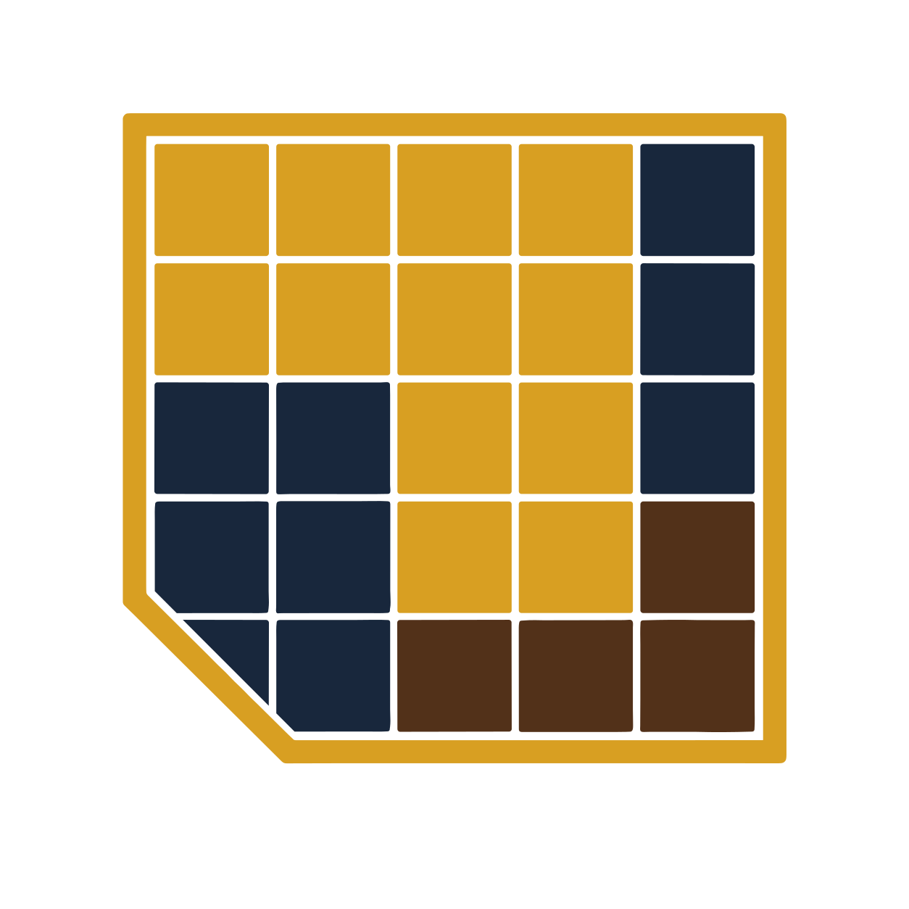

<p align="center">
  
</p>

# DTFetris

Aplicación de escritorio para automatizar la composición de planchas DTF. Distribuye diseños en una o más hojas de impresión mediante un algoritmo de packing automático, eliminando el cálculo manual de grids, duplicación y posicionado.

**Local, single-user, sin servidor remoto.**

## Stack

| Capa | Tecnología |
|---|---|
| Shell | Tauri 2 |
| Frontend | Vite 6 + React 18 + TypeScript 5 |
| Estado | Zustand 5 |
| Preview canvas | React Konva |
| Estilos | Tailwind CSS 3 |
| Backend | Rust 2021 (Tauri commands) |
| Exportación | `image` 0.25 (PNG), `resvg` 0.43 (rasterización SVG) |
| Tests unitarios | Vitest + React Testing Library |
| E2E | Playwright |

## Requisitos previos

- [Rust](https://rust-lang.org/es/learn/get-started/) — toolchain stable
- [Node.js](https://nodejs.org/) — v20+
- [pnpm](https://pnpm.io/) — `npm install -g pnpm`
- Dependencias de sistema de Tauri para tu OS — [ver docs de Tauri](https://tauri.app/start/prerequisites/)

## Puesta en marcha

```bash
pnpm install
pnpm dev
```

`tauri dev` compila el backend Rust y levanta el servidor Vite juntos.

## Uso del MVP

1. Seleccionar PNG/SVG e importar con su celda física en cm.
2. Editar cantidades, dimensiones y rotación; duplicar o eliminar cuando haga falta.
3. Configurar la plancha (inicial: **60 × 100 cm**) y pulsar **Generar planchas**.
4. Revisar todas las hojas y el aprovechamiento. Corregir cualquier copia que no quepa.
5. Exportar PNG a **300 DPI** y guardar el trabajo como JSON para recuperarlo después.

El arte conserva proporciones dentro de la celda. A tamaño inicial, la salida es **7087 × 11811 píxeles**, con transparencia. Varias planchas reciben sufijos `-001`, `-002`, etc.; no se sobrescriben PNG existentes.

Los diseños se copian a los datos privados de la aplicación. Conservar esa carpeta junto con el JSON: el trabajo no incorpora las imágenes ni es un paquete portable. Los SVG deben convertir texto a trazados; ver límites y comprobación de impresión en [la guía de trabajo real](docs/manual-dtf-check.md).

### Producción en Windows

`pnpm build` genera instaladores MSI/NSIS en `src-tauri/target/release/bundle/` y el ejecutable `src-tauri/target/release/dtf-sheet-optimizer.exe`. Requiere WebView2. No hace falta Node/Rust para utilizar la aplicación ya compilada.

## Comandos

| Comando | Descripción |
|---|---|
| `pnpm dev` | Modo desarrollo con hot reload |
| `pnpm build` | Bundle de producción |
| `pnpm test` | Tests unitarios con Vitest |
| `pnpm test:watch` | Vitest en modo watch |
| `pnpm test:e2e` | Tests E2E con Playwright |
| `pnpm lint` | ESLint sobre `src/` |
| `pnpm format` | Prettier sobre `src/` |

Tests Rust:

```bash
cd src-tauri && cargo test
```

## Estructura del proyecto

```
src/                    # Frontend React
  components/           # DesignList · SheetPreview · MetricsPanel
  store/                # Zustand store
  commands/             # Wrappers tipados sobre invoke()
  types/domain.ts       # DesignInput · Placement · Sheet
  utils/units.ts        # cmToPx(cm, dpi)
src-tauri/src/
  commands/             # Handlers de comandos Tauri (packing · export · persistence)
  domain/               # Structs Rust + algoritmo de packing
tests/e2e/              # Specs de Playwright
docs/                   # Arquitectura, requisitos, roadmap
```

## Documentación

Ver [`docs/`](./docs/) para decisiones de arquitectura, modelo de dominio, requisitos funcionales y roadmap.
